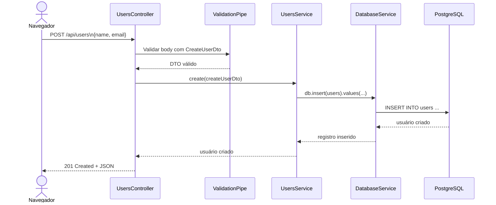
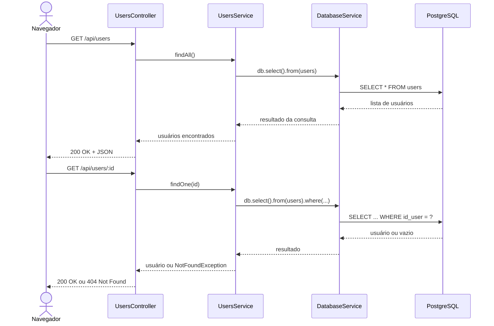
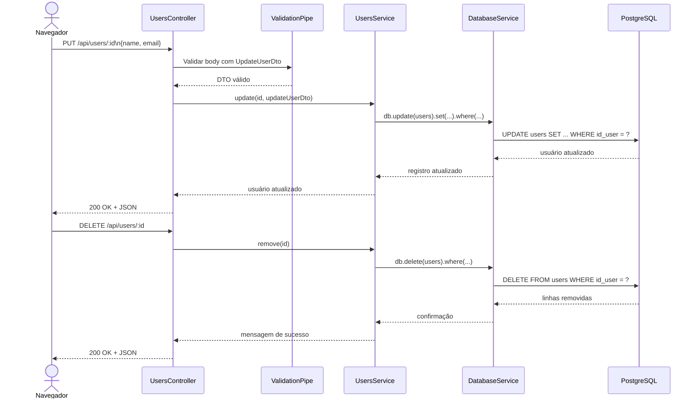

# CRUD simples com NestJS, Drizzle e PostgreSQL

Aplicação web simples para realizar CRUD de usuários com NestJS no servidor, Drizzle ORM no mapeamento do esquema e PostgreSQL no armazenamento.

## Tabela usada

O projeto trabalha com a tabela `users` abaixo:

```sql
CREATE TABLE users (
  id_user SERIAL NOT NULL PRIMARY KEY,
  name VARCHAR(100) NOT NULL,
  email VARCHAR(100)
);
```

## Como o projeto organiza essa tabela

Neste projeto, a definição da tabela aparece em duas camadas diferentes:

- No banco de dados, a tabela precisa existir fisicamente no PostgreSQL.
- No código, o arquivo `users.schema.ts` descreve essa mesma estrutura para o Drizzle ORM.

Em outras palavras, `server/src/modules/users/users.schema.ts` não cria a tabela sozinho. Ele define o esquema que o código vai usar para montar consultas com segurança de tipos. A criação física da tabela é feita pelo script `postgres/init.sql`, incluído na imagem do banco e executado na primeira inicialização de um volume vazio.

## Significado dos principais arquivos

### Arquivos do módulo de usuários

- `server/src/modules/users/users.schema.ts`
  Define o esquema da tabela `users` no Drizzle. Aqui ficam o nome da tabela, os nomes das colunas, seus tipos e restrições básicas, como `notNull()`.

- `server/src/modules/users/dto/create-user.dto.ts`
  Define o formato esperado para criar um usuário. Também concentra as validações da entrada, como obrigatoriedade do nome, tamanho mínimo e formato de e-mail.

- `server/src/modules/users/dto/update-user.dto.ts`
  Define o formato esperado para atualizar um usuário. Como a atualização é parcial, os campos são opcionais, mas continuam validados quando enviados.

- `server/src/modules/users/users.controller.ts`
  Recebe as requisições HTTP da API, como `GET`, `POST`, `PUT` e `DELETE`. O controller extrai parâmetros e corpo da requisição e delega a regra de negócio para o service.

- `server/src/modules/users/users.service.ts`
  Contém a regra de negócio do CRUD. É o service que usa `DatabaseService` e o schema `users` para inserir, consultar, atualizar e remover registros da tabela.

- `server/src/modules/users/users.module.ts`
  Agrupa as partes do domínio de usuários dentro do NestJS. O módulo registra o `UsersController`, o `UsersService` e importa o `DatabaseModule` para disponibilizar acesso ao banco.

### Arquivos de banco

- `server/src/database/database.service.ts`
  Cria a conexão com o PostgreSQL usando as variáveis de ambiente e instancia o Drizzle com o schema do projeto. Esse serviço expõe `db`, que é usado pelo `UsersService`.

- `server/src/database/database.module.ts`
  Torna o `DatabaseService` disponível para os outros módulos da aplicação.

### Arquivos de inicialização

- `server/src/app.module.ts`
  É o módulo raiz da aplicação. Ele carrega as configurações do `.env`, registra os módulos principais e configura o atendimento de arquivos estáticos.

- `server/src/main.ts`
  É o ponto de entrada da aplicação NestJS. Aqui a aplicação é inicializada, as validações globais são ativadas e o servidor começa a escutar na porta configurada.

## Fluxo da requisição até a tabela

Quando uma requisição chega em `POST /api/users`, o fluxo principal é este:

1. `users.controller.ts` recebe a requisição.
2. O Nest valida o corpo com `create-user.dto.ts`.
3. `users.service.ts` aplica a lógica de criação.
4. `database.service.ts` entrega a conexão com o banco.
5. O Drizzle usa `users.schema.ts` para montar o `INSERT` na tabela `users`.

## Diagramas UML das requisições HTTP

Os diagramas abaixo representam, em sequência, como a requisição HTTP atravessa as camadas da aplicação.

### 1. Criação de usuário (`POST /api/users`)



### 2. Consulta de usuários (`GET /api/users` e `GET /api/users/:id`)



### 3. Atualização e remoção (`PUT /api/users/:id` e `DELETE /api/users/:id`)



## Estrutura do projeto

```text
.
├── docker-compose.yml
├── postgres/
│   ├── Dockerfile
│   └── init.sql
└── server/
    ├── .env
    ├── package.json
    ├── public/
    └── src/
        ├── app.module.ts
        ├── main.ts
        ├── database/
        └── modules/
            └── users/
                └── dto/
```

As funcionalidades ficam em `server/src/modules/`. A conexão compartilhada com o banco fica em `server/src/database/`.

## Requisitos

- Node.js e npm.
- Docker com Docker Compose disponível e o serviço Docker em execução.
- Portas `5433` e `3003` disponíveis na máquina.

O PostgreSQL roda no container; a aplicação NestJS roda localmente.

## Configuração e execução

### 1. Construir a imagem e iniciar o container

Na raiz do projeto, onde está o `docker-compose.yml`, execute:

```bash
docker compose up -d --build postgres
```

Esse comando constrói a imagem definida em `postgres/Dockerfile` e inicia o container `postgres-nestjs` em segundo plano. A imagem usa PostgreSQL 17 e inclui o script `postgres/init.sql`.

Confira o estado do banco:

```bash
docker compose ps
docker compose logs postgres
```

Aguarde o serviço aparecer como `healthy` antes de usar a aplicação.

Na primeira inicialização de um volume vazio, o PostgreSQL cria o banco `bdaula` e executa o SQL que cria a tabela `users`. Os dados persistem no volume `postgres_data`.

Se o volume já foi inicializado, o script não será executado novamente ao reconstruir a imagem. Se o banco `bdaula` já existe e falta apenas a tabela, execute na raiz do projeto, em um terminal Bash:

```bash
docker compose exec -T postgres psql -U postgres -d bdaula < postgres/init.sql
```

Um volume criado com PostgreSQL 16 precisa de migração para ser usado pelo PostgreSQL 17; reconstruir a imagem não migra os dados.

### 2. Configurar as variáveis de ambiente

Crie ou ajuste `server/.env` com:

```env
PORT=3003

DB_HOST=localhost
DB_PORT=5433
DB_USER=postgres
DB_PASSWORD=postgres
DB_NAME=bdaula
```

A aplicação usa `localhost:5433`, que é encaminhado para a porta `5432` do PostgreSQL no container. O arquivo `.env` é ignorado pelo Git e precisa ser configurado em cada máquina.

### 3. Instalar as dependências e subir a aplicação

Partindo da raiz do projeto:

```bash
cd server
npm install
npm run dev
```

O comando `npm run dev` inicia o NestJS com recompilação automática ao alterar o código. Mantenha esse terminal aberto.

Abra no navegador:

```text
http://localhost:3003
```

### 4. Encerrar e iniciar novamente

Para encerrar a aplicação, pressione `Ctrl+C` no terminal em que executou `npm run dev`.

Para parar o banco, execute na raiz do projeto, em outro terminal:

```bash
docker compose stop postgres
```

Para iniciar o banco novamente:

```bash
docker compose up -d postgres
```

Depois, execute `npm run dev` dentro de `server/`. Use `--build` ao subir o banco se alterar o Dockerfile ou o SQL incluído na imagem, lembrando que o SQL de inicialização só é aplicado automaticamente em volumes vazios.

## Rotas da API

- `GET /api/users`
- `GET /api/users/:id`
- `POST /api/users`
- `PUT /api/users/:id`
- `DELETE /api/users/:id`
